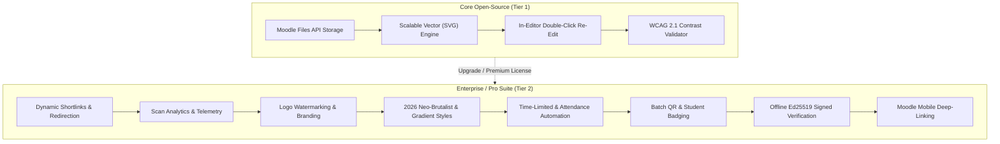
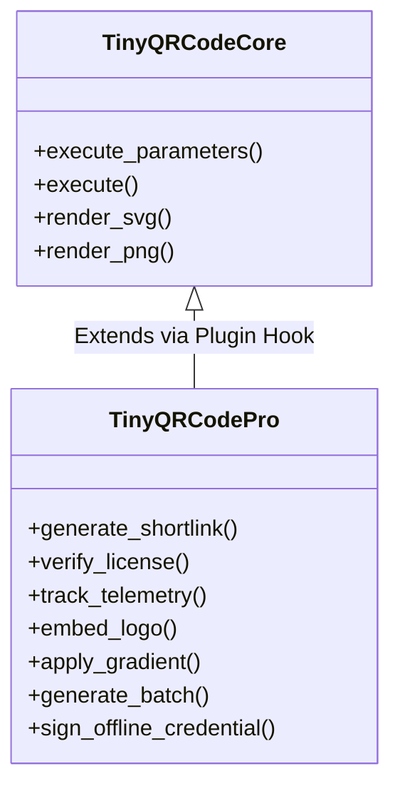
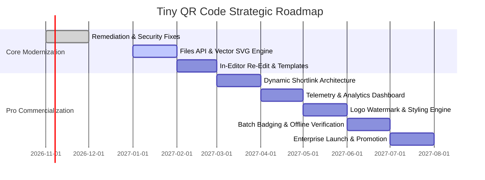

# Strategic Evolution & Premium Feature Roadmap: `tiny_qrcode`

**Product Concept:** Next-Generation Educational & Enterprise QR Code Suite for Moodle LMS  
**Target Horizon:** 2026 – 2027  
**Design Paradigm:** Sophisticated Minimalism, Bento-Grid UX, Glassmorphic Visuals & 2026 Neo-Brutalism  
**Document Status:** Strategic Planning & Product Specification  

---

## 1. Vision & Strategic Overview

While the initial version of `tiny_qrcode` provides basic raster image generation, modern educational institutions and corporate learning environments require **interactive, branded, trackable, and accessible** micro-engagements. 

This document defines two distinct product phases:
1. **Open-Source Core Enhancements (Tier 1 - Community Edition):** High-impact architectural upgrades that eliminate database bloat, provide vector graphics, and modernize the authoring workflow.
2. **Commercial & Enterprise Suite (Tier 2 - "Tiny QR Code Pro / Enterprise"):** High-margin, feature-rich paid capabilities that turn passive QR codes into dynamic telemetry channels for attendance, blended learning analytics, institutional branding, batch credentialing, and offline verification.



---

## 2. Open-Source Core Architectural Enhancements (Tier 1)

These enhancements address the structural limitations of the current plugin without requiring external infrastructure or paid licensing.

---

### 2.1 Native Moodle File Storage API (`mdl_files`)
* **Current Limitation:** PNG images are encoded as Base64 strings directly in HTML, inflating database text fields, breaking database backups (`.mbz`), and getting stripped by email clients.
* **Proposed Architecture:**
  1. The server receives the generation request and writes the binary image directly to Moodle's Draft File Storage area (`file_storage::create_file_from_string()`).
  2. The external service returns the draft file URL (`draftfile.php/.../qrcode.png`).
  3. When the teacher saves the activity or page, Moodle's core file subsystem automatically migrates the image to the permanent file area as `@@PLUGINFILE@@/qrcode.png`.
* **Benefits:**
  - **90% reduction** in database table text payload.
  - Zero image loss when courses are exported, imported, or duplicated.
  - Full support for HTTP caching headers (`ETag`, `Cache-Control`) and CDN edge-caching.
  - Full compatibility with email notifications (Moodle rewrites pluginfile URLs to absolute web links).

---

### 2.2 Scalable Vector Graphics (SVG) Rendering
* **Current Limitation:** The plugin only outputs fixed raster PNGs. When scaled up or displayed on 4K/Retina screens, QR codes appear blurry or pixelated.
* **Proposed Solution:** Integrate `Endroid\QrCode\Writer\SvgWriter`:
  - Allow authors to choose between **SVG** (recommended for web display & printing) and **PNG** (for legacy exports).
  - SVGs are resolution-independent, visually sharp on any display density, and average **under 4 KB** per code.

---

### 2.3 Interactive "Double-Click to Re-Edit" in TinyMCE
* **Current Limitation:** Once a QR code is inserted, it is a static image. If the author made a typo in the URL or wants to change the color, they must delete the image and rebuild it from scratch.
* **Proposed Solution:**
  1. Store configuration metadata in the generated image's HTML5 data attributes:
     ```html
     
     ```
  2. Add a TinyMCE selection listener (`editor.on('dblclick')`) and context menu option (`Edit QR Code`).
  3. When clicked, the modal re-opens with all form fields, sliders, and color pickers **pre-populated** with the existing settings, updating the element in-place upon submission.

---

### 2.4 Real-Time Live Preview & WCAG 2.1 Contrast Validator
* **Current Limitation:** Authors have no idea what their QR code looks like or whether it will scan until after insertion.
* **Proposed Solution:**
  - **Live Client-Side Canvas:** Embed a lightweight client-side QR renderer in the modal dialog that reacts instantly as the user types or adjusts sliders.
  - **WCAG Contrast Warning:** If the author selects colors with a contrast ratio below 4.5:1 (e.g., yellow foreground on white background), the UI displays a real-time warning: *"Low contrast: this QR code may be difficult for mobile cameras to scan."*

---

## 3. Commercial & Premium Tier ("Tiny QR Code Pro")

The Enterprise/Pro tier targets universities, K-12 school districts, corporate academies, and LMS administrators requiring **analytics, security, dynamic redirection, and visual design**.

---

### Feature 1: Dynamic Shortlinks & Instant Destination Redirection

> **The Problem:** Instructors print course syllabi, laboratory manuals, textbook guides, or poster displays with static QR codes. If a link changes or needs updating, hundreds of physical printouts become obsolete.

* **Pro Solution:** The modal offers a **"Dynamic Trackable QR Code"** toggle.
* **Mechanism:**
  1. Instead of embedding the direct destination URL, the plugin generates a permanent institutional shortlink:
     `https://moodle.example.edu/lib/editor/tiny/plugins/qrcode/r.php?id=8f9a2b`
  2. When scanned, Moodle logs the telemetry event and issues an HTTP 302 redirect to the destination URL.
  3. **In-LMS Redirection Management:** The teacher or course admin can change the target URL at any time from an admin tab without re-printing or re-inserting the QR code.

---

### Feature 2: Deep Scan Analytics & Engagement Telemetry

Transform passive print/screen codes into measurable learning interactions.

* **Real-time Analytics Dashboard:**
  - Total Scans vs. Unique Student Scans.
  - Time-of-Day Engagement Heatmap.
  - Device and OS telemetry (iOS Camera vs. Android Lens vs. Third-Party Scanner).
* **Gradebook & Activity Completion Trigger:**
  - Ability to bind a dynamic QR code to an **Activity Completion** event.
  - *Example:* Scanning the QR code located on a physical laboratory station automatically marks the "Lab Session Safety Check" activity as completed for the student.
* **Moodle Learning Analytics Integration:**
  - Emits Moodle Events (`\tiny_qrcode\event\code_scanned`) for custom logstore reporting and early intervention dashboards.

```
┌────────────────────────────────────────────────────────────────────────┐
│ 📊 Dynamic QR Analytics: "Chemistry Lab 3 Protocol"                    │
├────────────────────────┬───────────────────────┬───────────────────────┤
│ Total Scans: 342       │ Unique Students: 78   │ Avg Scan Time: 09:15  │
├────────────────────────┴───────────────────────┴───────────────────────┤
│ Engagement Velocity:                                                   │
│ [████████████████████████████████░░░░░░░░░░░░] 74% Course Coverage     │
├────────────────────────────────────────────────────────────────────────┤
│ Top Devices: 62% iOS Safari • 34% Android Chrome • 4% Other            │
└────────────────────────────────────────────────────────────────────────┘
```

---

### Feature 3: Institutional Branding & Custom Logo Watermarking

* **High-Density Center Emblem:** Automatically utilizes `ErrorCorrectionLevel::High` (30% error tolerance) to embed institutional logos, faculty crests, or custom avatars directly in the center of the QR matrix.
* **Logo Management Library:**
  - Site Administrators can upload standard institution branding logos (`Site Admin -> Plugins -> Tiny QR Code Pro`).
  - Teachers select approved institution crests from a dropdown or upload custom icons with automatic circular framing and boundary padding.

---

### Feature 4: 2026 Neo-Brutalist & Modern Aesthetic Customizer

Bypass outdated black-and-white grids in favor of modern, high-end 2026 digital aesthetics.

* **Curated 2026 Neo-Brutalist Palettes:**
  - High-contrast, intentional palettes adhering to the **60-30-10 Rule**:
    - *Electric Cyber:* Slate background (`#0f172a`), deep indigo modules (`#312e81`), neon cyan finder eyes (`#06b6d4`).
    - *Editorial Warm:* Cream card (`#fefce8`), rich charcoal modules (`#1c1917`), burnt ochre accents (`#ea580c`).
    - *Nordic Frost:* Frosted glass background with deep navy modules (`#0f2027`) and subtle organic drop shadows.
* **Dot Matrix Geometry Options:**
  - Rounded Dots / Liquid modules.
  - Diamond / Rhombus modules.
  - Geometric Neo-Brutalist blocks with heavy outer borders.
* **Gradient Overlays:**
  - Linear and radial dual-tone gradients across the QR matrix with contrast auto-balancing.

---

### Feature 5: Time-Limited & Attendance Automation Codes

* **Expiring QR Codes:**
  - Set expiration timestamps (e.g., active for only 15 minutes during a live lecture).
  - After expiration, the code redirects to a customizable "Session Expired" notification page.
* **Campus Geofencing & IP Restriction:**
  - Restrict valid scans to students connected to campus Wi-Fi IP ranges or within classroom GPS boundaries.
  - Prevents remote link-sharing among students who are absent from the physical classroom.

---

### Feature 6: Multi-Payload Education Templates

One-click builders tailored specifically for teachers:

| Template | What It Generates | Pedagogical Benefit |
| :--- | :--- | :--- |
| **Course / Assignment** | Auto-populates current course, activity, or discussion URL | Direct access from paper handouts to online forums |
| **Instructor vCard** | Scannable contact card with office hours, room number, email | Instant contact saving on student mobile phones |
| **Classroom Wi-Fi** | `WIFI:S:LabNet;T:WPA;P:Secret;;` string | Frictionless connectivity in physical computer labs |
| **Calendar Event (iCal)**| Date, time, location for exams or guest lectures | Adds exam dates directly to students' phone calendars |
| **Instant Feedback** | Pre-addressed feedback email or WhatsApp link | Low-friction student sentiment collection |

---

### Feature 7: Batch Generation for Student Badging & Course Packs

* **Bulk Student Badges:** Generate individualized QR codes for all students enrolled in a course or cohort, embedding encrypted student IDs for check-in stations, field trips, or examination halls.
* **Printable PDF Export:** Generates ready-to-print PDF sticker sheets (e.g., Avery 2x4 labels) containing course QR codes, student badges, or equipment station tags directly from the Moodle course administration menu.

---

### Feature 8: Offline Cryptographically Signed Credentials (Ed25519)

* **Tamper-Proof Offline Verification:**
  - For certificate validation, exam tickets, or student verification in environments without reliable internet connectivity.
  - The QR code contains a micro-payload signed with the institution's Ed25519 private key.
  - Any standard verifier app can validate the digital signature and student credential entirely offline using the institution's public key.

---

### Feature 9: Native Moodle Mobile Deep-Linking

* **Seamless App Transitions:**
  - Generates deep-link URL schemes (`moodlemobile://link=https%3A%2F%2Flms...`).
  - When scanned by a phone camera, it bypasses the mobile browser and opens the exact course, quiz, or forum directly inside the official Moodle Mobile App.

---

## 4. UI/UX Concept: Bento-Grid Modal Dialog

The proposed redesign replaces the standard form with a compartmentalized **Bento-Grid layout** following modern 2026 UI trends:

```
┌────────────────────────────────────────────────────────────────────────┐
│  Insert QR Code                                            [ ✕ Close ] │
├───────────────────────────────────┬────────────────────────────────────┤
│  [Bento 1: Payload & Preset]      │  [Bento 2: Real-time Live Preview] │
│  Type: [ Course Link ▾ ]          │                                    │
│  Target: https://lms.edu/mod/view │             ┌────────┐             │
│                                   │             │ █ ▄ █  │             │
│  [Bento 3: Geometry & Size]       │             │ ▄ █ ▄  │             │
│  Size: ─────●────── 250px         │             └────────┘             │
│  Shape: [ Rounded Dots ▾ ]        │  ✓ WCAG AAA Contrast (8.2:1)       │
│                                   │  Resolution: Vector SVG            │
│  [Bento 4: Neo-Brutalist Palette] │                                    │
│  Preset: [ Electric Slate ▾ ]     │  [Bento 5: Pro Telemetry]          │
│  Foreground: [#06b6d4]  Bg: [#0f17]│  ☑ Dynamic Link  ☑ Track Scans     │
├───────────────────────────────────┴────────────────────────────────────┤
│  [ Cancel ]                                       [ Insert into Editor ]│
└────────────────────────────────────────────────────────────────────────┘
```

---

## 5. Monetization Strategy & Technical Architecture



### Licensing & Delivery Models
1. **Freemium Distribution on Moodle.org:**
   - The core open-source plugin remains 100% free under GNU GPL v3 on the official Moodle Plugins Directory.
   - Promotes brand visibility, trust, and adoption across hundreds of thousands of Moodle sites.
2. **Pro Sub-Plugin / License Key Activation:**
   - A companion plugin (`tiny_qrcodepro`) or license key entry in Site Administration unlocks the dynamic shortlinks, analytics, logo watermarks, and attendance modules.
   - **Pricing Tiers:**
     - *Single Institution:* \$199 – \$499 / year per LMS instance.
     - *Campus Enterprise / Multi-Tenant:* \$999 – \$1,999 / year with unlimited dynamic codes and priority SLA support.
     - *Hosted SaaS Analytics Addon:* Optional cloud dashboard for institutions that prefer not to store telemetry in their local Moodle database.

---

## 6. Implementation Milestones



---

## 7. Strategic Recommendations & Next Steps

1. **Immediate Action:** Apply the fixes detailed in [`remediation_and_fix_guide.md`](file:///home/bs01065/.gemini/antigravity/brain/53fcd618-aa9d-4c82-855e-f045258916e9/remediation_and_fix_guide.md) to eliminate security vulnerabilities and achieve Moodle 5.x / TinyMCE 8 stability.
2. **Community Release:** Package the remediated version as `v1.0.0` and submit it to the official Moodle Plugins Directory.
3. **Pro Prototype:** Build a minimal viable prototype of the **Dynamic Shortlinks** and **Custom Logo Watermark** features to validate demand with enterprise higher-education clients.
